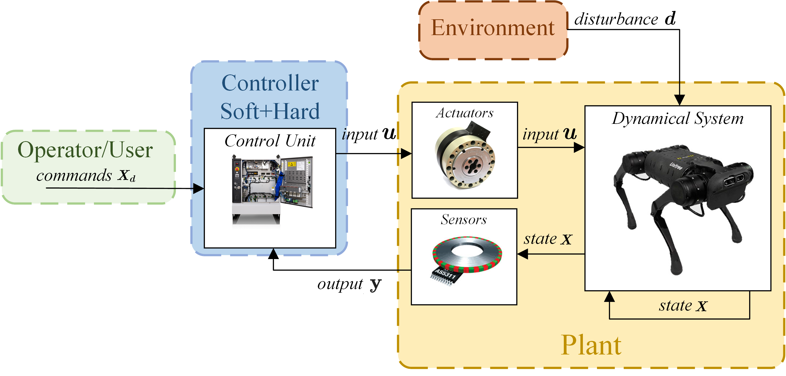
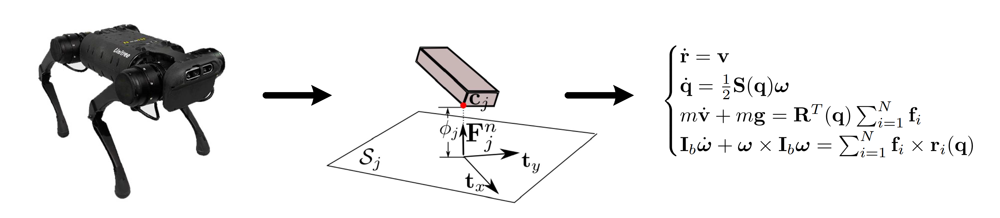
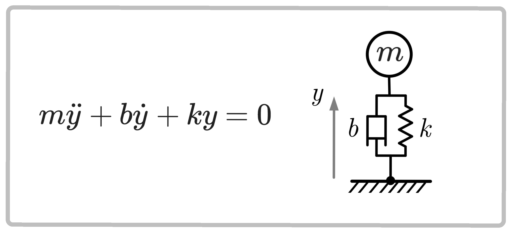
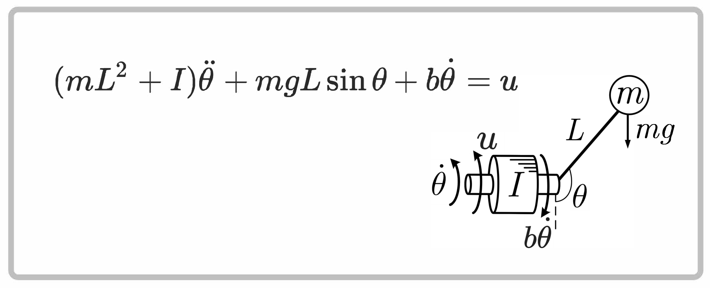
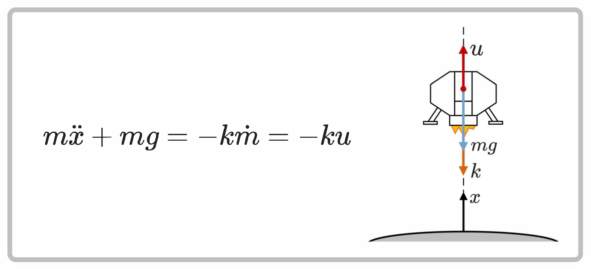
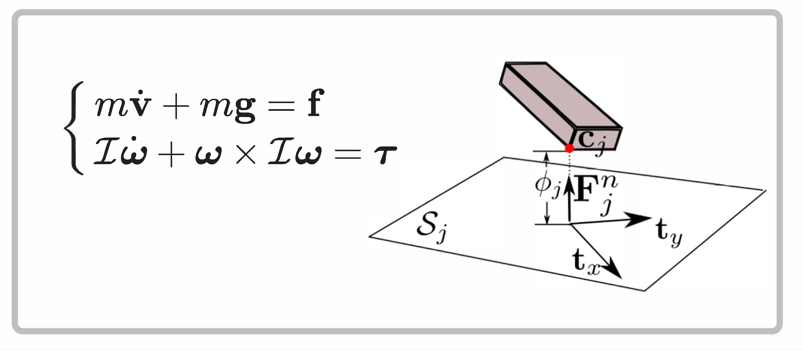
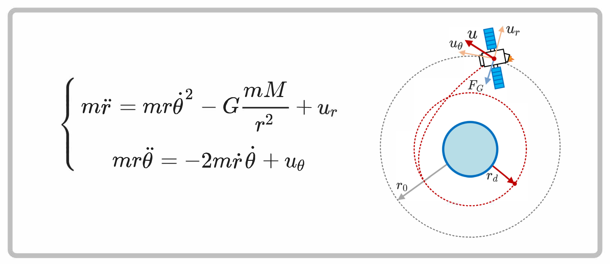
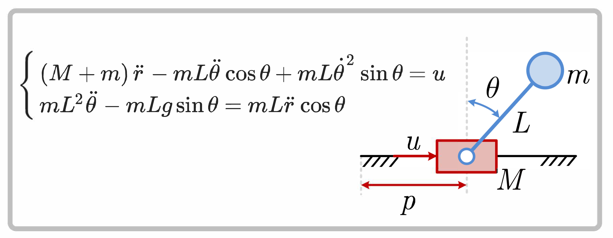

A robot’s pose tells us where it is. To predict what happens next, we also need its velocity, the forces acting on it, and a model of how those forces produce motion.

This lecture builds that model step by step: **describe the system → choose its state → write the equations → simulate its motion**. We use the original modeling figures and examples, then connect them to MuJoCo’s UR5e, G1, and Go2 models in [practice 01](../../practices/p01-simulation/README.md).

> **Keep this question in mind:** what information is missing when you see only a still image of a robot?

## 1. Robotic system

The diagram shows the path from a desired behavior to robot motion, and the measurement path back to the controller.

<figure class="lecture-figure" id="figure-forc-robot-scheme">
<a class="figure-link" href="images/forc_robot_scheme.png" target="_blank" rel="noopener" aria-label="Open full-size figure: Operator, controller, actuators, robot, sensors, and environment connected in a feedback loop.">

Open full-size figure ↗
</a>
<figcaption>Figure 1 · The robot as a system. Follow the command path to the plant and the observation path back to the controller.</figcaption>
</figure>

**Read the arrows:** an actuator command is not necessarily a force. MuJoCo’s `ctrl` must be interpreted through the actuator’s force law.

A robot operates through several connected components:

- The **operator or planner** specifies desired behavior.
- **Actuators** convert commands into forces; transmissions determine where those forces act.
- The **mechanical system** moves under actuator, environmental, and internal forces.
- **Sensors** measure selected quantities, with their own noise, delay, and calibration.
- A **controller** uses available observations to choose commands.
- The **environment** supplies gravity, contact, and disturbances.

A simulator replaces a chosen part of this physical chain with a computational model. It does not automatically supply a controller, accurate sensors, or a faithful model of motor electronics. A detailed mesh establishes appearance; it does not establish accurate inertial or friction parameters.

Our aim today is to describe the plant, choose a state, and simulate its motion. Initially we assume access to full simulator state and make the actuator law explicit. An ideal torque source is a model assumption, not a property of every robot actuator.

## 2. Dynamical systems

A dynamical system has quantities that evolve over time, possibly under external inputs. Examples include mechanical systems, electrical circuits, and biological processes. For a robot, the same configuration can lead to different future motion when initial velocity or applied force changes.

Useful classifications describe different properties:

- **SISO / MIMO:** one input and one output / multiple inputs and outputs. A robot arm is typically MIMO.
- **Continuous / discrete time:** differential equations / a sampled transition rule.
- **Causal:** the present response depends on present and past inputs, not future inputs.
- **Time invariant / time varying:** the governing rule has no explicit time dependence / explicitly changes with time. Moving state does not by itself make a system time varying.
- **Linear / nonlinear:** superposition holds / generally fails. Rigid-body geometry, velocity products, saturation, and contact make robot dynamics nonlinear.

## 3. Mathematical models

A model keeps the physical effects needed to answer a particular question. The same quadruped can be represented at several levels of detail.

<figure class="lecture-figure" id="figure-robot-to-model-blank">
<a class="figure-link" href="images/robot_to_model_blank.png" target="_blank" rel="noopener" aria-label="Open full-size figure: A quadruped is abstracted into a rigid body with contact forces and equations of motion.">

Open full-size figure ↗
</a>
<figcaption>Figure 2 · From a physical robot to an idealized body and equations. Choose the abstraction before choosing a numerical solver.</figcaption>
</figure>

**Notation in the figure:** its $q$ denotes orientation. Here $Q$ is a quaternion and $q$ is the full configuration. We define frames explicitly below and use $r\times F$ for the moment of a force about a reference point.

A mathematical model is an abstraction chosen for a question. For practice 01, we assume rigid links, prescribed joints, fixed inertial parameters, and the contact and actuator laws encoded in the model. We initially inspect simulator state directly. This **full-state access** is a teaching assumption, not a claim about what a physical robot measures.

There are two different errors to investigate:

- **Modeling error:** the chosen masses, geometry, friction, actuator law, or assumptions differ from the real plant.
- **Numerical error:** the computer approximates the chosen equations using finite timesteps and solver tolerances.

Reducing the timestep can help the second error. It does not repair an incorrect mass or a missing actuator delay.

**Practice connection:** load and render each robot before using its arrays. Identify its base, moving links, ground, and nominal pose. Then ask which of those visible features actually affect the dynamics.

## 4. Differential equations

A differential equation relates a function to its derivatives. In mechanics, the function describes a physical quantity and the derivatives describe rates of change. Newton's laws and energy principles provide relationships between position, velocity, acceleration, and force.

An **ordinary differential equation (ODE)** has one independent variable, usually time. An explicit equation of order $n$ has the form

$$
z^{(n)}=F(t,z,\dot z,\ldots,z^{(n-1)}).
$$

An implicit equation instead satisfies

$$
\mathcal F(t,z,\dot z,\ldots,z^{(n)})=0.
$$

An initial-value problem also specifies initial conditions. For a second-order mechanical equation, initial position and velocity are needed. A rendered pose supplies only part of this information.

Transfer functions and impulse responses describe input-output behavior, especially for linear systems. State-space models are useful here because we need internal configuration, velocity, contact, and actuator quantities as well as observations.

## 5. State-space models

For a deterministic system, a sufficient state contains the information needed to predict the future when future inputs and disturbances are specified. In local coordinates, write

$$
\dot x=f(x,u,d,t),
$$

$$
y=s(x,u,d,t).
$$

- $x$ is the state; $x(t_0)=x_0$ specifies an initial condition.
- $u$ is the commanded input.
- $d$ represents external influences that the model does not choose.
- $y$ is an observation, which can contain only part of the state.

The state choice is not unique. Joint angles and Cartesian coordinates can describe related physical configurations, but they carry different constraints. Including redundant coordinates without their constraints does not create a valid model.

A higher-order equation can be written as first-order equations by adding the required derivatives to the state. For mechanical systems, this usually means configuration and velocity; an actuator with its own dynamics also needs activation state. We will return to MuJoCo's `qpos`, `qvel`, and `act` after deriving the mechanical equations.

## 6. Linear systems

For a linear model,

$$
\dot x=A(t)x+B(t)u,
$$

$$
y=C(t)x+D(t)u.
$$

Constant matrices give a linear time-invariant model. Here $D$ represents direct input-to-output dependence; it need not be zero. We study local linear approximations later; practice 01 evaluates the nonlinear model itself.

### Example: mass–spring–damper

This example shows the main state-space step: turn one second-order equation into two first-order equations.

<figure class="lecture-figure" id="figure-mbk-eq">
<a class="figure-link" href="images/mbk_eq.png" target="_blank" rel="noopener" aria-label="Open full-size figure: A mass attached to a spring and damper, with the unforced second-order equation.">

Open full-size figure ↗
</a>
<figcaption>Figure 3 · A mass with a spring and damper. Displacement is measured from static equilibrium; the pictured equation has no applied input.</figcaption>
</figure>

**Set the convention:** the figure uses $y$ for displacement. Below we call it $z$, reserving $y$ for an observation, and add an applied force $u$.

For a one-dimensional mass, spring, and damper with applied force $u$,

$$
m\ddot z+b\dot z+kz=u.
$$

Choose $x=(z,v)$, with $v=\dot z$:

$$
\dot x=
\begin{bmatrix}0&1\\-k/m&-b/m\end{bmatrix}x+
\begin{bmatrix}0\\1/m\end{bmatrix}u.
$$

The key step is adding velocity to the state. The homogeneous equation alone describes only the zero-input case. In MuJoCo bookkeeping, spring and damper forces belong to the passive side of the force balance.

For a constant input $u_0$, a linear time-invariant equilibrium satisfies

$$
Ax^\star+Bu_0=0.
$$

For a linear time-invariant model:

- An invertible $A$ gives one equilibrium for that input; a singular $A$ can give none or a family.
- In continuous time, the equilibrium is asymptotically stable when every eigenvalue of $A$ has strictly negative real part.
- The transient consists of the system's modes, with polynomial factors possible for repeated defective eigenvalues.
- Superposition holds.
- For a stable system, a sustained sinusoidal input produces a steady-state response at the same frequency after transients decay.

These statements require their linear-model assumptions; they do not transfer automatically to a robot with contact.

## 7. Nonlinear systems

Robot geometry, velocity products, and contact generally break superposition. A nonlinear state-space model has the form

$$
\dot x=f(x,u,d,t).
$$

$$
y=s(x,u,d,t).
$$

There may be zero, one, or several equilibria, and an analytical trajectory is often unavailable. Nonlinear does not mean explicitly time varying: the pendulum below is nonlinear even with constant parameters and no explicit time dependence.

### Example: nonlinear pendulum

The pendulum keeps the same position–velocity state construction, but introduces a nonlinear gravity term.

<figure class="lecture-figure" id="figure-pend-eq">
<a class="figure-link" href="images/pend_eq.png" target="_blank" rel="noopener" aria-label="Open full-size figure: A pendulum with gravity, applied motor torque, inertia, and viscous damping.">

Open full-size figure ↗
</a>
<figcaption>Figure 4 · Applied torque, gravity, inertia, and damping determine pendulum motion.</figcaption>
</figure>

**Set the convention:** $L$ in the figure becomes $\ell$ below. We measure the angle from the downward vertical and write the total pivot inertia as $m\ell^2+I_C$.

Measure angle $\theta$ from the downward vertical. With COM offset $\ell$, inertia $I_C$ about the COM, damping $b$, and applied torque $u$,

$$
(m\ell^2+I_C)\ddot\theta+mg\ell\sin\theta+b\dot\theta=u.
$$

With $x=(\theta,\omega)$,

$$
\dot x=
\begin{bmatrix}
\omega\\
\frac{u-mg\ell\sin\theta-b\omega}{m\ell^2+I_C}
\end{bmatrix}.
$$

Gravity belongs in bias and damping in passive force. The sine term breaks superposition; the system need not have a unique equilibrium.

### Example: variable-mass lander

The lander adds a different modeling lesson: if a quantity changes and affects future acceleration, it must be included in the state.

<figure class="lecture-figure" id="figure-lander-eq">
<a class="figure-link" href="images/lander_eq.png" target="_blank" rel="noopener" aria-label="Open full-size figure: A variable-mass lander with gravity and an upward thrust generated by exhaust.">

Open full-size figure ↗
</a>
<figcaption>Figure 5 · A lander loses mass while producing thrust. Its state must include the remaining mass.</figcaption>
</figure>

**Distinguish input from force:** the archived equation uses $u=\dot m$ for mass flow and $k$ for exhaust speed. Below these are $u_m\leq0$ and $v_e>0$, so upward thrust is $-v_eu_m$.

For a vertical variable-mass vehicle, let $z$ increase upward, $g>0$, exhaust speed $v_e>0$, and mass flow $u_m=\dot m\leq0$. Ignoring drag,

$$
\begin{aligned}
\dot z &= v,\\
\dot v &= -g-\frac{v_e}{m}u_m,\\
\dot m &= u_m.
\end{aligned}
$$

The state must include mass because future acceleration depends on it. Validity requires $m>0$ and a fuel-depletion rule. The practice's Menagerie models have fixed mass parameters; a free joint does not automatically implement variable-mass dynamics.

## 8. Generalized mechanical systems

Let $q$ denote configuration and $v$ the independent generalized velocity. For hinge and slide coordinates, $v=\dot q$; floating-base orientation needs the tangent-space treatment introduced below.

We use MuJoCo's bias convention:

$$
M(q)\dot v+c(q,v)=\tau+J_c^{\mathsf T}f_c.
$$

- $M$ is the `nv` by `nv` generalized inertia matrix.
- $c$ contains **gravity and velocity-dependent inertial terms**.
- $\tau$ collects nonconstraint generalized forces.
- $J_c^{\mathsf T}f_c$ is the generalized contribution of constraints.

The subscript on $J_c$ distinguishes the constraint Jacobian from a tool-point Jacobian. Constraints include contacts, joint limits, and equality constraints; the active row count can change with state.

For the nonsingular models used here, $M$ is symmetric positive definite. It couples the accelerations of different degrees of freedom. A torque applied at one joint need not accelerate only that joint.

Forces paired with translational coordinates have units N; those paired with rotational coordinates have units N·m. The input vector $u$ becomes a generalized force through the actuator transmission. For ideal direct motors,

$$
\tau_{\mathrm{act}}=B(q)u.
$$

The examples below show why the coordinates and the input mapping must be specified together. We will map each force to its MuJoCo field in section 10.

### From mechanical equations to state space

For an ordinary hinge/slide-coordinate system, choose $x=(q,v)$ with $v=\dot q$. Then

$$
\dot x=\begin{bmatrix}
v\\
M(q)^{-1}\bigl(\tau+J_c^{\mathsf T}f_c-c(q,v)\bigr)
\end{bmatrix}.
$$

For floating-base configurations, replace the first row by $N(q)v$; quaternion derivatives are not angular velocity components. Contact forces must be resolved consistently with the state and applied forces. The inverse symbol describes the mathematics; numerical code uses a solve.

### Example: floating rigid body

Separate the translation of the center of mass from rotation about it. This is the starting point for understanding a robot’s floating base.

<figure class="lecture-figure" id="figure-srb-eq">
<a class="figure-link" href="images/srb_eq.png" target="_blank" rel="noopener" aria-label="Open full-size figure: A floating rigid body near a contact surface, with normal gap and normal and tangential axes.">

Open full-size figure ↗
</a>
<figcaption>Figure 6 · A floating body above a surface. The gap and contact axes will also be used for the legged robots.</figcaption>
</figure>

**Gravity convention:** the figure places a gravity bias on the left. Below $g^W$ is physical gravitational acceleration and appears on the right. Torque and inertia are defined about the COM.

For an isolated rigid body, a useful split is world-frame translation of its COM and body-frame rotation:

$$
m\dot v_C^W=mg^W+F^W,
$$

$$
I_B\dot\omega^B+\omega^B\times(I_B\omega^B)=T_C^B.
$$

Here $I_B$ is the inertia about the COM expressed in body axes; the torque is also about the COM. The gyroscopic term does not disappear merely because $I_B$ is constant. Force and torque must be expressed with their declared axes and origin.

For a quaternion describing body-to-world rotation,

$$
\dot Q=\frac12Q\otimes(0,\omega^B).
$$

This connects the three angular-velocity components to the four quaternion derivatives. Use `mj_integratePos` rather than implementing a new quaternion integrator in the practice.

G1 and Go2 are **articulated floating robots**, not isolated rigid bodies. Their full inertia includes coupling between the base and moving limbs. Internal motor torques change joint motion, but cannot provide an arbitrary external force on the whole robot. Gravity and environmental contact act on whole-system momentum.

**Prediction before simulation:** with contacts removed and no other external forces, the robot COM has gravitational acceleration regardless of internal joint torques. With ground contact, normal and friction forces change that momentum balance. This is why we load and view both legged robots before discussing contact.

### Example: artificial satellite

Changing coordinates also changes the force that is paired with each coordinate. A satellite in polar coordinates makes this visible.

<figure class="lecture-figure" id="figure-satt-eq">
<a class="figure-link" href="images/satt_eq.png" target="_blank" rel="noopener" aria-label="Open full-size figure: A satellite in a central gravitational field with radial and tangential applied forces.">

Open full-size figure ↗
</a>
<figcaption>Figure 7 · Radial and tangential forces on a satellite. Angular generalized force is a torque.</figcaption>
</figure>

**Read the second equation carefully:** multiply the tangential force equation by $r$ before identifying the angular inertia and generalized torque.

For a constant-mass satellite in a plane, choose $q=(r,\theta)$ and physical radial/tangential forces $(F_r,F_t)$. Let $\mu=GM_{\mathrm{planet}}$. Then

$$
M(q)=\begin{bmatrix}m&0\\0&mr^2\end{bmatrix}.
$$

$$
c(q,v)=\begin{bmatrix}
-mr\dot\theta^2+m\mu/r^2\\
2mr\dot r\dot\theta
\end{bmatrix},
$$

$$
Q=\begin{bmatrix}F_r\\rF_t\end{bmatrix}.
$$

The angular generalized force is a torque, not a tangential force in new units. Multiplying the tangential force equation by $r$ produces the symmetric mechanical inertia above. This is the same work-consistency principle used in the Jacobian-transpose wrench mapping. Central gravity is also different from the uniform gravity vector used by the practice scenes.

### Example: cart-pole

The cart-pole demonstrates coupling and underactuation: one applied force influences two coordinates.

<figure class="lecture-figure" id="figure-cart-pole-eq">
<a class="figure-link" href="images/cart_pole_eq.png" target="_blank" rel="noopener" aria-label="Open full-size figure: A force-driven cart and unactuated pole, with coupled equations of motion.">

Open full-size figure ↗
</a>
<figcaption>Figure 8 · The actuator pushes the cart; the pole joint is unactuated.</figcaption>
</figure>

**Fix the sign convention:** below, the pole’s horizontal coordinate is $r-\ell\sin\theta$. This defines the signed angle used in the equations; the archived drawing is schematic.

For a cart with mass $m_c$, a point-mass pole $m_p$ at length $\ell$, cart coordinate $r$, and pole angle $\theta$ from upright, choose pole horizontal position $r-\ell\sin\theta$. Then

$$
M(q)=\begin{bmatrix}
m_c+m_p&-m_p\ell\cos\theta\\
-m_p\ell\cos\theta&m_p\ell^2
\end{bmatrix}.
$$

$$
c(q,v)=\begin{bmatrix}
m_p\ell\dot\theta^2\sin\theta\\
-m_pg\ell\sin\theta
\end{bmatrix}.
$$

If the actuator pushes the cart with force $u$,

$$
Q=Bu,
\qquad
B=\begin{bmatrix}1\\0\end{bmatrix}.
$$

Choosing $(0,1)^{\mathsf T}$ would instead actuate the pole joint. The lesson for a robot is to inspect the actuator transmission before interpreting its control vector.

## 9. Other model classes

A system is **control affine** when, in a suitable local state representation,

$$
\dot x=f_0(x)+G(x)u.
$$

Unconstrained rigid-body dynamics with ideal unsaturated torque inputs have this structure. A driftless model has $f_0=0$; an ordinary robot under gravity is not driftless simply because its commands are zero. Saturation, actuator dynamics, and contact require additional care.

An ideal constrained mechanism can be written as a differential-algebraic system:

$$
M\dot v+c=\tau+J_c^{\mathsf T}\lambda,
\qquad
\phi(q)=0.
$$

Rigid friction and impact models can instead require set-valued laws or differential inclusions. MuJoCo's softened constraints should not be silently identified with an exact rigid DAE or an ideal discontinuous impact law.

For fixed geometry, standard unconstrained rigid-body inertial terms can also be expressed linearly in suitable inertial parameters $\pi$:

$$
Y(q,v,\dot v)\pi=\tau.
$$

This regressor form is useful for parameter identification. It does not mean the dynamics are linear in state, nor that every friction or actuator parameter enters linearly. These model classes provide context for later courses; they are not additional software dependencies for practice 01.

## 10. Connect the equations to MuJoCo

We now use the same ideas to inspect actual robot models. Follow the order below: first understand what the simulator stores, then ask for geometric quantities, forces, energy, and contact.

<aside class="documentation-note" aria-label="How to use the MuJoCo references">

**Using the references.** Links in this lecture target MuJoCo **3.13.0**, the version used in the practice. Read the physical interpretation here, then use the linked reference to check array dimensions, coordinate frames, and function arguments.

The function reference shows C signatures. In Python, a call such as `mujoco.mj_forward(model, data)` uses the corresponding binding; output arrays are often supplied as arguments and modified in place. The [Python function conventions](https://mujoco.readthedocs.io/en/3.13.0/python.html#functions) explain these differences.

</aside>

### 10.1. Describe the model; allocate its state

MuJoCo separates three objects with different jobs:

1. **[`MjSpec`](https://mujoco.readthedocs.io/en/3.13.0/python.html#model-editing)** is an editable description: bodies, joints, inertias, geometry, actuators, and options.
2. **[`MjModel`](https://mujoco.readthedocs.io/en/3.13.0/APIreference/APItypes.html#mjmodel)** is the compiled structure and parameter set used for calculations.
3. **[`MjData`](https://mujoco.readthedocs.io/en/3.13.0/APIreference/APItypes.html#mjdata)** stores one simulation instance's state, inputs, and computational workspace.

Several `MjData` objects can share one model. This lets the notebook compare nearby configurations without overwriting the main experiment. A structural edit belongs in the specification, followed by compilation and allocation of matching data. Changing a state belongs in `MjData`. See the [model-editing workflow](https://mujoco.readthedocs.io/en/3.13.0/programming/modeledit.html).

For the robot models in this practice, a useful physical state is

$$
x=(q,v,a),
$$

where $a$ denotes optional actuator activation, **not acceleration**. Acceleration is written $\dot v$ throughout these notes.

- `qpos` stores configuration $q$; its storage length is `nq`.
- `qvel` stores generalized velocity $v$; its length is `nv`.
- `act` stores activation $a$; its length is `na`.
- `ctrl` stores input $u$; its length is `nu`.
- `qacc` stores the computed or requested generalized acceleration $\dot v$.
- `sensordata` contains outputs of the sensors defined in the model; it is not automatically the full state.

For exact simulation replay, save more than $(q,v)$: time, activation when present, applied inputs, and relevant numerical state such as solver warm starts can matter. Physical state and a complete simulator checkpoint are different concepts. The [state components reference](https://mujoco.readthedocs.io/en/3.13.0/programming/simulation.html#state-components) specifies what each saved-state category includes.

**Three operations to distinguish:**

- [`mj_forward`](https://mujoco.readthedocs.io/en/3.13.0/APIreference/APIfunctions.html#mj-forward): update derived quantities without advancing time.
- [`mj_step`](https://mujoco.readthedocs.io/en/3.13.0/APIreference/APIfunctions.html#mj-step): compute dynamics and advance the state.
- [Rendering](https://mujoco.readthedocs.io/en/3.13.0/python.html#rendering): draw the current state without integrating it.

Editing `qpos` alone leaves previously computed positions, Jacobians, and force arrays stale. Call `mj_forward` before querying them; the [simulation pipeline](https://mujoco.readthedocs.io/en/3.13.0/computation/index.html#simulation-pipeline) explains the order in which these quantities are computed.

### 10.2. Count configuration and velocity coordinates

For a hinge-only arm, configuration can locally be represented by joint angles and

$$
\dot q=v.
$$

For a floating body, orientation is part of configuration. MuJoCo stores a free joint using three position components and a unit quaternion:

$$
q_{\mathrm{free}}=(p_x,p_y,p_z,Q_w,Q_x,Q_y,Q_z).
$$

The quaternion has four stored components but only three independent degrees of freedom. Its associated velocity has six components:

$$
v_{\mathrm{free}}=(v_x,v_y,v_z,\omega_x,\omega_y,\omega_z).
$$

For a free joint, linear velocity uses world axes and angular velocity uses local body axes. Quaternion storage is scalar-first, $(w,x,y,z)$, and $Q$ and $-Q$ represent the same orientation. Other spatial APIs can use different component orders; [`mj_objectVelocity`](https://mujoco.readthedocs.io/en/3.13.0/APIreference/APIfunctions.html#mj-objectvelocity), for example, returns angular components before linear components. Always specify both **axes and reference point**.

The general kinematic relation is

$$
\dot q=N(q)v,
$$

where $N(q)$ maps tangent velocity to the derivative of the chosen configuration representation. You do not need to build $N$ to integrate a MuJoCo configuration.

For the pinned Menagerie models:

- UR5e: `nq = 6`, `nv = 6`, `nu = 6`.
- G1: `nq = 36`, `nv = 35`, `nu = 29`.
- Go2: `nq = 19`, `nv = 18`, `nu = 12`.

Each legged robot has one free joint: the extra stored quaternion component explains `nq = nv + 1`. The six unactuated base velocities explain `nv = nu + 6` for these particular motor arrangements. This is a property of these models, not a universal actuator-count identity.

Use manifold-aware operations:

$$
q^+=q\oplus\delta q,
\qquad
\delta q\in\mathbb R^{n_v}.
$$

- [`mj_integratePos`](https://mujoco.readthedocs.io/en/3.13.0/APIreference/APIfunctions.html#mj-integratepos) applies a tangent displacement using a velocity and time interval.
- [`mj_differentiatePos`](https://mujoco.readthedocs.io/en/3.13.0/APIreference/APIfunctions.html#mj-differentiatepos) computes the tangent difference between configurations, divided by the supplied interval.
- With an interval of one, the latter returns a local displacement; it does not mean that an experiment lasted one second.

Read joint addresses through `jnt_qposadr` and `jnt_dofadr`; joint indices are not generally array offsets. Ordinary subtraction of quaternion components gives neither angular velocity nor a meaningful three-dimensional orientation difference. See the [course notation contract](../../site/content/notation.md) and MuJoCo’s [joint definitions](https://mujoco.readthedocs.io/en/3.13.0/XMLreference.html#body-joint) for the free, ball, slide, and hinge representations.

### 10.3. Query positions, velocities, and Jacobians

Kinematics describes geometry and motion without asking which forces produce that motion. For a body frame $B$ in world frame $W$, a point with body coordinates $r^B$ has world position

$$
r^W=p^W_B+R_{WB}r^B.
$$

The body origin and its center of mass are generally different points. `xpos` and `xmat` describe body-frame pose; `xipos` describes the body center of mass in world coordinates. A named site can identify a tool point without giving that point its own mass or collision shape.

For a chosen point and orientation frame, the translational and angular Jacobians satisfy

$$
\dot p^W=J_p(q)v,
\qquad
\omega^W=J_r(q)v.
$$

Both have three rows and `nv` columns. A Jacobian maps **velocity degrees of freedom**, not quaternion storage components. Choose the query matching the point in your equation: [`mj_jacBody`](https://mujoco.readthedocs.io/en/3.13.0/APIreference/APIfunctions.html#mj-jacbody) for a body origin, [`mj_jacBodyCom`](https://mujoco.readthedocs.io/en/3.13.0/APIreference/APIfunctions.html#mj-jacbodycom) for its COM, or [`mj_jacSite`](https://mujoco.readthedocs.io/en/3.13.0/APIreference/APIfunctions.html#mj-jacsite) for a named site. These queries return Jacobian components in world axes.

Differentiating once more gives

$$
\ddot p^W=J_p(q)\dot v+\dot J_p(q,v)v.
$$

The second term matters even when generalized acceleration is zero: a rotating link can have centripetal acceleration. The notebook checks this expression against nearby states using [`mj_jacDot`](https://mujoco.readthedocs.io/en/3.13.0/APIreference/APIfunctions.html#mj-jacdot).

To express the same physical velocity in body axes, rotate its components:

$$
\dot p^B=R_{WB}^{\mathsf T}\dot p^W.
$$

This is a coordinate transformation of a vector. It is not generally the time derivative of the point coordinates in a moving frame; differentiating a rotating basis adds transport terms.

For link masses $m_i$ and world COM positions $p_i$, the whole-robot COM is

$$
p_{\mathrm{COM}}=\frac{\sum_i m_i p_i}{\sum_i m_i}.
$$

$$
J_{\mathrm{COM}}=\frac{\sum_i m_iJ_{p_i}}{\sum_i m_i}.
$$

**Practice connection:** use UR5e body and COM queries, compare local/world velocities, and test a Jacobian column by perturbing configuration. A kinematic animation prescribes poses; it does not demonstrate that a robot can dynamically execute them.

### 10.4. Account for each force

Separate the total applied force into named contributions:

$$
\begin{aligned}
M\dot v+c={}&\tau_{\mathrm{act}}+\tau_{\mathrm{pass}}\\
&+\tau_{\mathrm{gen}}+\tau_{\mathrm{cart}}+\tau_{\mathrm{con}}.
\end{aligned}
$$

- `qfrc_actuator` gives $\tau_{\mathrm{act}}$ after actuator transmission and limits.
- `qfrc_passive` gives $\tau_{\mathrm{pass}}$, including passive spring and damping contributions.
- `qfrc_applied` gives user-specified generalized force $\tau_{\mathrm{gen}}$.
- Body wrenches in `xfrc_applied` must be mapped to $\tau_{\mathrm{cart}}$.
- `qfrc_constraint` gives $\tau_{\mathrm{con}}$.

The array `qfrc_bias` is the left-hand-side vector $c$. For the practice models, with body gravity compensation disabled, gravity is not also added as a passive force. Define

$$
g(q)=c(q,0).
$$

$$
c_{\mathrm{vel}}(q,v)=c(q,v)-g(q).
$$

The legacy notes call the full bias $h$. Here $h$ and $c$ would denote the **same full vector**; neither is an additional force. Some textbooks use $C(q,v)v+g(q)$ instead. The matrix $C$ is not unique, so the practice compares the resulting force vector. MuJoCo’s [general dynamics framework](https://mujoco.readthedocs.io/en/3.13.0/computation/index.html#general-framework) defines the signs and dimensions of these terms; its [passive-force description](https://mujoco.readthedocs.io/en/3.13.0/computation/index.html#passive-forces) also covers gravity compensation when enabled.

`ctrl` is not generally a generalized-force vector: its meaning depends on the actuator law.

For direct torque motors with no activation dynamics or saturation, write

$$
\tau_{\mathrm{act}}=B(q)u,
\qquad
B\in\mathbb R^{n_v\times n_u}.
$$

A joint transmission, gear ratio, or tendon determines this mapping. Position actuators instead interpret their inputs as targets and generate force through a servo law. In the interactive script, G1/Go2 use unit-gear torque motors with preserved effort limits, so each input is a joint torque. The notebook's original UR5e model retains its position actuators during model inspection. **Zero motor torque and a zero position target are different experiments.**

<aside class="documentation-note" aria-label="Actuator references">

**Trace the input to the joint.** Read the [actuation model](https://mujoco.readthedocs.io/en/3.13.0/computation/index.html#actuation-model) for transmission, activation, and force generation. Compare the MJCF [motor](https://mujoco.readthedocs.io/en/3.13.0/XMLreference.html#actuator-motor) and [position](https://mujoco.readthedocs.io/en/3.13.0/XMLreference.html#actuator-position) definitions before interpreting `ctrl`.

</aside>

### 10.5. Ask for acceleration or required force

Forward dynamics finds acceleration given state and inputs:

$$
\dot v=M(q)^{-1}\left(\tau+J_c^{\mathsf T}f_c-c(q,v)\right).
$$

This equation is a mathematical description, not a recommendation to form an inverse matrix. The notebook uses a dense linear solve as a small-model check. MuJoCo uses structured dynamics calculations and factorization, and contact forces must be resolved consistently with the dynamics.

Inverse dynamics finds the required generalized force given configuration, velocity, and a **requested acceleration**:

$$
\tau_{\mathrm{inverse}}=
M\dot v+c-\tau_{\mathrm{pass}}-\tau_{\mathrm{con}}.
$$

Set `qacc` before calling [`mj_inverse`](https://mujoco.readthedocs.io/en/3.13.0/APIreference/APIfunctions.html#mj-inverse), then read `qfrc_inverse`. This result is not automatically a feasible `ctrl`: a floating robot has unactuated directions, force limits may bind, and actuator input dimension can differ from `nv`. Forward/inverse agreement also depends on constraint-solver convergence; see the [inverse-dynamics workflow](https://mujoco.readthedocs.io/en/3.13.0/programming/simulation.html#inverse-dynamics) for this distinction.

An equilibrium of an autonomous model requires a state that remains constant under the chosen constant input. For a stateless-actuator robot at rest,

$$
v=0,\qquad\dot v=0.
$$

$$
c(q,0)=\tau+J_c^{\mathsf T}f_c.
$$

A keyframe is a stored configuration and possibly stored input; it is not a certificate of equilibrium. A rendered image does not even establish zero velocity. A floating robot needs support forces, and a nominal standing pose can collapse if its actuator commands are removed.

**Worked diagnostic:** for a consistent forward calculation, form

$$
\begin{aligned}
r={}&M\dot v+c-\tau_{\mathrm{act}}-\tau_{\mathrm{pass}}\\
&-\tau_{\mathrm{gen}}-\tau_{\mathrm{cart}}-\tau_{\mathrm{con}}.
\end{aligned}
$$

A small residual checks internal consistency of the force accounting. It does not validate the physical robot model. Omit $\tau_{\mathrm{cart}}$ only when Cartesian applied loads are zero. This matters especially when using mouse perturbations in the viewer.

### 10.6. Check energy and mechanical power

For a rigid-body model with generalized velocity $v$,

$$
T(q,v)=\frac12 v^{\mathsf T}M(q)v.
$$

$$
L=T-V.
$$

$T$ is kinetic energy, $V$ is potential energy, and $L$ is the Lagrangian. In ordinary independent coordinates with $v=\dot q$, the Euler–Lagrange equation is

$$
\frac{d}{dt}\frac{\partial L}{\partial\dot q}
-\frac{\partial L}{\partial q}=Q_{\mathrm{nc}},
$$

where $Q_{\mathrm{nc}}$ contains forces not already represented by potential energy. This explains why inertia, gravity, and velocity products appear together in mechanical dynamics. Quaternion components are constrained coordinates; do not insert four orientation components into an unconstrained Euclidean derivation and treat them as four independent rotations.

For the spring-free UR5e example,

$$
\frac{\partial V}{\partial q}=g(q).
$$

The notebook compares the kinetic-energy query [`mj_energyVel`](https://mujoco.readthedocs.io/en/3.13.0/APIreference/APIfunctions.html#mj-energyvel) with the mass-matrix expression and checks the potential energy from [`mj_energyPos`](https://mujoco.readthedocs.io/en/3.13.0/APIreference/APIfunctions.html#mj-energypos) by differentiating it numerically. The routines write potential and kinetic energy to `data.energy[0]` and `data.energy[1]`, respectively. Damping dissipates energy and does not belong in $V$. Springs contribute potential energy but their forces appear in MuJoCo's passive-force channel; do not count them twice in a balance equation.

Total energy is conserved only under appropriate assumptions. Actuation, damping, contact, and numerical integration can all change it. Potential energy also has an arbitrary reference level; compare energy changes, not an unexplained absolute offset.

#### External wrench and virtual work

Apply world-frame force $F$ and torque $T_p$ at a specified body point. Their equivalent generalized force is

$$
\tau_{\mathrm{wrench}}=J_p^{\mathsf T}F+J_r^{\mathsf T}T_p.
$$

The power must agree in both descriptions:

$$
v^{\mathsf T}\tau_{\mathrm{wrench}}
=(J_pv)^{\mathsf T}F+(J_rv)^{\mathsf T}T_p.
$$

This identity explains the transpose Jacobian: it preserves mechanical work. [`mj_applyFT`](https://mujoco.readthedocs.io/en/3.13.0/APIreference/APIfunctions.html#mj-applyft) performs the point-force/torque mapping into a supplied generalized-force array. A force at the wrist origin and the same force at the wrist COM can produce different joint torques. Use the same point and axes on both sides of a check.

### 10.7. Inspect G1 and Go2 contacts

An ideal frictionless rigid contact can be described using gap $\phi(q)$ and normal force $f_n$:

$$
\phi(q)\geq0,\qquad f_n\geq0.
$$

$$
\phi(q)f_n=0.
$$

These express nonpenetration, a pushing-only normal force, and contact complementarity. MuJoCo uses a regularized soft-constraint formulation; the ideal equations are intuition, not exact assertions to impose on every simulated contact. Small penetration can coexist with a finite force. The [soft-contact model](https://mujoco.readthedocs.io/en/3.13.0/computation/index.html#soft-contact-model) explains why MuJoCo relaxes the ideal complementarity condition.

For an isotropic sliding-friction cone, the ideal bound is

$$
\lVert f_t\rVert\leq\mu f_n.
$$

MuJoCo supports [elliptic and pyramidal friction cones](https://mujoco.readthedocs.io/en/3.13.0/computation/index.html#friction-cones). Do not test a pyramidal approximation using an elliptic norm inequality. The [contact dimension (`condim`)](https://mujoco.readthedocs.io/en/3.13.0/computation/index.html#condim) determines whether it supports only normal force or also sliding friction, torsional friction, and rolling friction. More contact components do not mean more configuration coordinates.

In the practice:

1. Inspect G1 and Go2's initial poses and contact geom names.
2. Read each contact's dimension and the model's cone setting.
3. Use [`mj_contactForce`](https://mujoco.readthedocs.io/en/3.13.0/APIreference/APIfunctions.html#mj-contactforce) to obtain force-then-torque components in the **contact frame**.
4. Compare the resulting generalized constraint force with the full dynamics balance.

The contact frame is not the world frame; its first axis is the normal. Also, `ncon` counts detected contacts while `nefc` counts active scalar constraint rows. They need not be equal, and other constraints can contribute to `nefc`.

Contact force is not another freely selected motor input. It depends on geometry, motion, friction, and the constraint solve. A model can be geometrically plausible yet predict poor contact behavior if foot shapes, friction, or solver parameters are unsuitable.

### Browser experiment: a floating Go2

**Predict first:** with zero motor torque, will the robot remain in its initial pose? Which changes first: base height, joint velocity, or contact force?

Load the real Menagerie Go2 below, inspect its meshes and collision geometry, then advance one physics step. Compare two release heights using **Save current trace as Run A → Reset → Play**. Explain why changing the initial state changes the trajectory without changing the robot model.

<iframe class="lecture-experiment" src="../../experiments/go2/?lesson=models" title="Go2 modeling experiment with live state plots" loading="lazy" height="1050"></iframe>

[Open the modeling experiment in a full page](../../experiments/go2/?lesson=models) for more plotting space. The browser experiment uses MuJoCo 4.0.0; the Python practice remains pinned to 3.13.0. The timestep is 2 ms in this browser experiment. Compare physical quantities and assumptions before comparing trajectories across versions.

## 11. Simulate the motion

For a Euclidean ODE, the exact integral relation includes the initial state:

$$
x(t)=x_0+\int_{t_0}^{t} f(x(\tau),u(\tau),\tau)\,d\tau.
$$

Numerical simulation approximates that evolution with a discrete map:

$$
x_{k+1}=F_{\Delta t}(x_k,u_k).
$$

$$
t_k=t_0+k\Delta t.
$$

Explicit Euler illustrates the idea:

$$
x_{k+1}\approx x_k+\Delta t\,f(x_k,u_k,t_k).
$$

For mechanical systems, a semi-implicit update instead uses the updated velocity for configuration:

$$
v_{k+1}=v_k+\Delta t\,\dot v_k.
$$

$$
q_{k+1}=q_k\oplus(\Delta t\,v_{k+1}).
$$

These formulas explain discretization; they are not a replacement implementation of MuJoCo's damping treatment or constraint solver. MuJoCo offers Euler, Runge–Kutta, and implicit integration options with different numerical properties; the [integrator comparison](https://mujoco.readthedocs.io/en/3.13.0/computation/index.html#integrators) explains their treatment of velocity-dependent forces. Read `model.opt.integrator` and `model.opt.timestep` instead of assuming defaults. A higher formal integration order does not guarantee a better contact experiment.

### Physics and rendering are different clocks

The interactive `run.py` uses

$$
\Delta t=0.002\ \mathrm{s},
\qquad f_{\mathrm{physics}}=500\ \mathrm{Hz}.
$$

It publishes state to the passive viewer every ten physics steps:

$$
\Delta t_{\mathrm{view}}=10\Delta t=0.020\ \mathrm{s}.
$$

$$
f_{\mathrm{view}}=50\ \mathrm{Hz}.
$$

The [passive viewer](https://mujoco.readthedocs.io/en/3.13.0/python.html#passive-viewer) handles screen redraws independently. Its `sync()` method exchanges state and user interaction with the simulation loop. Mouse perturbations arrive on viewer synchronization and persist between those updates. The script paces wall-clock execution approximately; a slow machine can simulate less than one simulated second per real second without changing the physical timestep. Notebook video capture has its own chosen rate.

Reducing drawing frequency saves presentation work; increasing the physics timestep changes the numerical experiment. A future controller will have its own update rule, introduced in practice 02.

### A convergence experiment

Halve $\Delta t$ while preserving initial state, model, applied-input history, and simulated duration. Compare trajectories at the same physical times. To keep viewer updates at 50 Hz, change from ten to twenty steps per update. Do not use a hand-dragged mouse trajectory as a repeatable force input for this test.

Measure more than appearance: finite states, force residuals, energy changes, contact forces, and end-state differences. Contact events can shift with timestep and long trajectories can diverge; a single visually similar rollout is weak evidence. Solver tolerance controls a different numerical approximation from timestep.

## 12. Prepare for practice 01

Changing `qpos` asks how the **same robot** behaves at another configuration. Changing damping, mass, collision geometry, or actuator definitions asks about a **different model**.

The notebook obtains a fresh Menagerie specification, changes a joint's damping, compiles it, and allocates fresh data. This is a controlled model experiment: change one parameter, state its units, and predict which equations or force channels should change before running the simulation. Use the [Python model-editing examples](https://mujoco.readthedocs.io/en/3.13.0/python.html#model-editing) for `MjSpec`, and the [MJCF joint reference](https://mujoco.readthedocs.io/en/3.13.0/XMLreference.html#body-joint) to check what the damping parameter means.

Before practice, be ready to:

- Identify configuration, velocity, input, and observation separately.
- Explain `nq`, `nv`, `nu`, and the free-joint quaternion.
- Distinguish body origin, COM, local axes, and world axes.
- Account for every force in the generalized dynamics equation.
- Explain why a keyframe and a rendered pose do not establish equilibrium.
- Describe what is recomputed by `mj_forward` and advanced by `mj_step`.

The practical sequence is **view → inspect coordinates → check kinematics → check dynamics and energy → load floating robots → inspect contact → simulate → edit a model**. Follow [practice 01](../../practices/p01-simulation/README.md) for installation and execution.

### Check your understanding

Try to answer before opening the explanation.

G1 stores 36 positions but has 35 velocities. Which number determines the mass-matrix size?

It is $35\times35$; velocity and force live in the tangent space. The extra quaternion component is a storage constraint.

A Go2 keyframe has zero velocity. Must <code>qacc</code> vanish?

No. Forward dynamics may find unbalanced gravity, actuation, and contact forces.

Does <code>ctrl = 0</code> mean no actuator force?

For the script's stateless torque motors, yes, in the absence of other actuator effects. For a position servo it means a zero target, which can generate nonzero force.

A residual fails only while dragging a body. What is missing?

Check the generalized contribution of `xfrc_applied`, using the correct body COM and frame, and refresh state-dependent quantities.

Why can a point accelerate when <code>qacc</code> is zero?

Its Jacobian can change along the trajectory, producing $\dot J_pv$.

What changes when the timestep is halved at fixed duration and 50 Hz viewer updates?

Twice as many physics steps and twenty steps per viewer update.

Why does a small force residual not prove realism?

It checks consistency within the assumed model. Physical validation needs measured or independent evidence.

Which channel changes directly when joint damping increases?

Passive force. At a fixed moving state its dissipative contribution changes; the resulting acceleration changes too.

## Reading and model documentation

Use these references by task. **To understand a result**, start with Computation. **To call a function**, check the Python conventions and API reference. **To change the robot**, use the modeling guide, XML reference, and `MjSpec` examples together.

- [Python bindings and function conventions](https://mujoco.readthedocs.io/en/3.13.0/python.html#functions): argument order, output arrays, and the relationship to the C API.
- [MuJoCo computation, version 3.13](https://mujoco.readthedocs.io/en/3.13.0/computation/index.html): generalized dynamics, actuation, constraints, and integration.
- [MuJoCo API functions, version 3.13](https://mujoco.readthedocs.io/en/3.13.0/APIreference/APIfunctions.html): exact query and simulation contracts.
- [MJCF modeling guide](https://mujoco.readthedocs.io/en/3.13.0/modeling.html): bodies, joints, collision geometry, inertial parameters, and defaults.
- [MJCF XML reference](https://mujoco.readthedocs.io/en/3.13.0/XMLreference.html): available model elements and attributes.
- [Model editing with `MjSpec`](https://mujoco.readthedocs.io/en/3.13.0/programming/modeledit.html): edit, compile, and create matching simulation data.
- [MuJoCo Menagerie](https://github.com/google-deepmind/mujoco_menagerie): robot descriptions, model-specific assumptions, assets, and licenses.
- [@mit-multibody]: an independent derivation of multibody mechanics; translate its symbols using the convention in section 8.

### About the figures and this edition

The eight figures are copied unchanged from the archived lecture’s `images/` directory. Captions identify notation differences; see the [figure provenance](images/README.md). This lecture develops the modeling, state-space, mechanical-system, and ODE-integration material in `_legacy/content/_sort/01_modeling/01_modeling_notes.md` and its companion notebook. The archive remains unchanged. The current notes correct the missing initial condition in the integral equation, the cart-pole input placement, and the polar-coordinate generalized inertia/input pairing, and replace the old standalone integration exercise with the MuJoCo robot workflow.
