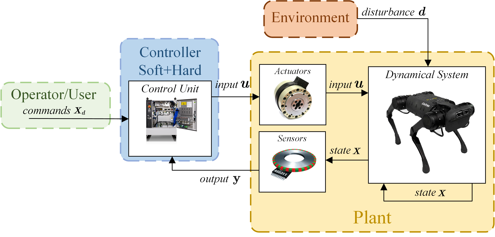
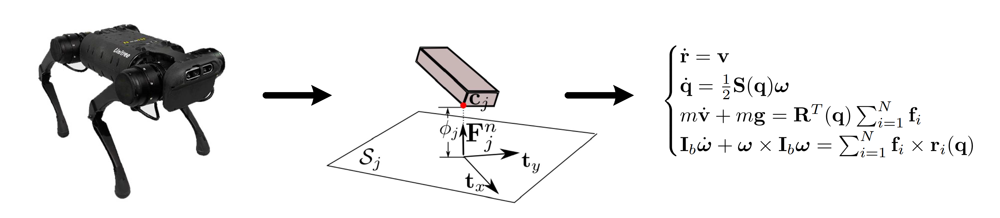
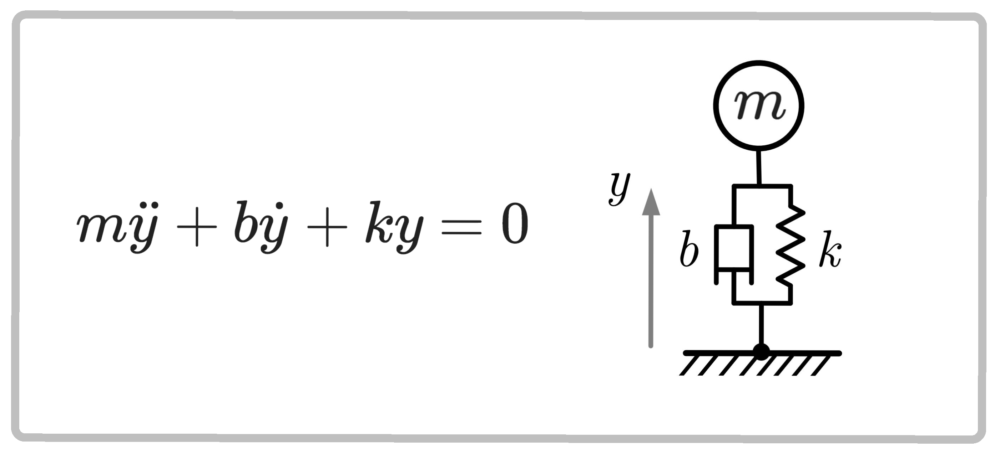
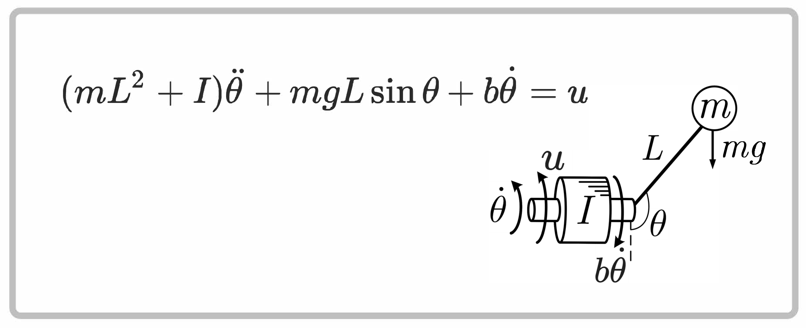
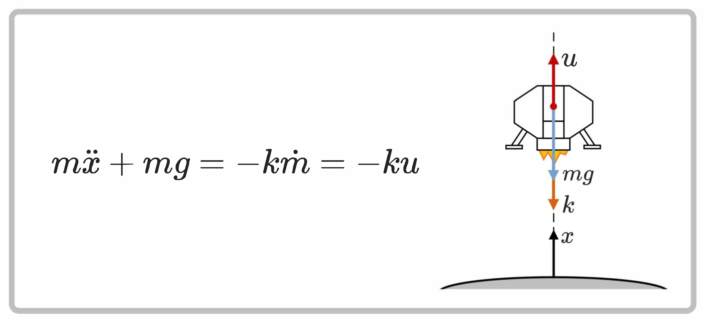
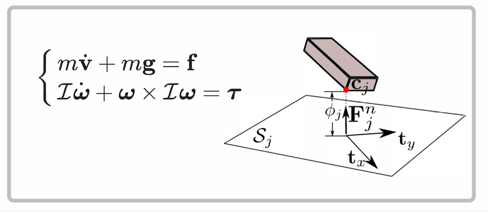
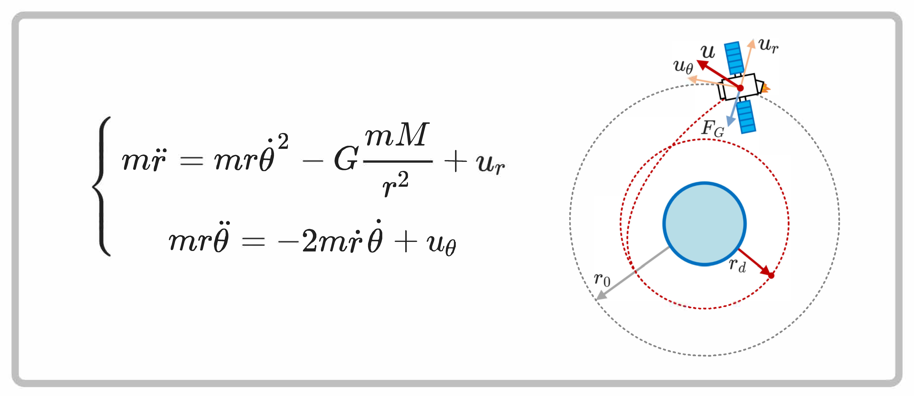
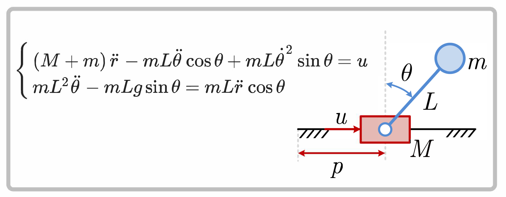

## Robotic system

<figure class="lecture-figure">

<figcaption>Original FORC system diagram: distinguish actuator commands, mechanical forces, state, and observations.</figcaption>
</figure>

**Today:** describe the plant, build a model, and simulate its motion.

---
## Dynamical systems

A system evolves over time under inputs and disturbances.

- SISO / MIMO: how many inputs and outputs?
- Continuous / discrete time: ODE or sampled transition?
- Causal: no dependence on future inputs.
- Time invariant / varying: does the rule explicitly depend on time?
- Linear / nonlinear: does superposition hold?

---
## Mathematical models

<figure class="lecture-figure">

<figcaption>Original abstraction diagram; the text defines current quaternion, frame, and moment conventions.</figcaption>
</figure>

Which details can we omit for the question we want to answer?

Modeling error and numerical error are different.

---
## Differential equations

Explicit ODE of order $n$:

$$
z^{(n)}=F(t,z,\dot z,\ldots,z^{(n-1)})
$$

Implicit form:

$$
\mathcal F(t,z,\dot z,\ldots,z^{(n)})=0
$$

A second-order initial-value problem needs position **and velocity**.

---
## State-space models

$$
\dot x=f(x,u,d,t),\qquad y=s(x,u,d,t)
$$

State plus specified future inputs must determine future evolution.

For a robot, use configuration, velocity, and optional activation:

$$
x=(q,v,a).
$$

A pose alone does not determine motion.

---
## Linear systems

$$
\dot x=A(t)x+B(t)u,\qquad y=C(t)x+D(t)u
$$

- Constant matrices: linear time-invariant model.
- Robot geometry, velocity products, and contact introduce nonlinearity.
- Time-varying state does not imply a time-varying model.

Local linearization follows in practice 02.

---
## Example: mass–spring–damper

<figure class="lecture-figure">

<figcaption>The original figure uses displacement y about static equilibrium and no applied input.</figcaption>
</figure>

Add a force input and choose $x=(z,v)$.

$$
\dot x=\begin{bmatrix}0&1\\-k/m&-b/m\end{bmatrix}x+\begin{bmatrix}0\\1/m\end{bmatrix}u.
$$

---
## Nonlinear systems: pendulum

<figure class="lecture-figure">

<figcaption>Original example: the sine of the angle makes the dynamics nonlinear.</figcaption>
</figure>

Choose $x=(\theta,\omega)$; specify the angle reference before deriving the gravity sign.

Nonlinear systems need not have a unique equilibrium.

---
## Example: variable-mass lander

<figure class="lecture-figure">

<figcaption>The figure’s u is mass flow in the equation; thrust is −vₑuₘ.</figcaption>
</figure>

$$
\dot z=v,\qquad \dot v=-g-\frac{v_e}{m}u_m,\qquad \dot m=u_m.
$$

Mass must be part of the state.

---
## Generalized mechanical systems

$$
M(q)\dot v+c(q,v)=\tau+J_c^{\mathsf T}f_c
$$

- $M$: generalized inertia, `nv` by `nv`.
- $c$: gravity plus velocity-dependent bias, `qfrc_bias`.
- $\tau$: nonconstraint generalized forces.
- $J_c^{\mathsf T}f_c$: `qfrc_constraint`.

The legacy symbol $h$ denotes the same full bias as $c$ here.

---
## Account for every force

$$
\tau=\tau_{\mathrm{act}}+\tau_{\mathrm{pass}}
+\tau_{\mathrm{gen}}+\tau_{\mathrm{cart}}
$$

- `qfrc_actuator`: delivered actuator force.
- `qfrc_passive`: springs, damping, other passive forces.
- `qfrc_applied`: supplied generalized force.
- `xfrc_applied`: body wrenches; map them to generalized force.

Gravity is already included in the bias on the left-hand side.

---
## Mechanical equations in state space

For hinge and slide coordinates with $v=\dot q$:

$$
\dot x=\begin{bmatrix}
v\\
M^{-1}(\tau+J_c^{\mathsf T}f_c-c)
\end{bmatrix}.
$$

For a floating base, the first row becomes $N(q)v$.

Solve for acceleration; do not form an explicit matrix inverse.

---
## Example: floating rigid body

<figure class="lecture-figure">

<figcaption>Original free-body diagram. The text uses physical gravity gᵂ on the right of the force equation.</figcaption>
</figure>

Specify the axes and the point about which torque and inertia are defined.

---
## From a free body to a legged robot

$$
m\dot v_C^W=mg^W+F^W
$$

$$
I_B\dot\omega^B+\omega^B\times(I_B\omega^B)=T_C^B
$$

G1 and Go2 add limb motion and base–joint coupling.

Internal motor torques cannot supply an arbitrary net external force. Ground contact changes the whole-system momentum balance.

---
## Example: artificial satellite

<figure class="lecture-figure">

<figcaption>Original equations resolve physical forces; angular generalized force is r times tangential force.</figcaption>
</figure>

$$
M=\operatorname{diag}(m,mr^2),\qquad Q=\begin{bmatrix}F_r\\rF_t\end{bmatrix}.
$$

---
## Example: cart-pole

<figure class="lecture-figure">

<figcaption>Original coupled equations. The applied force pushes the cart, not the pole joint.</figcaption>
</figure>

$$
Q=Bu,\qquad B=\begin{bmatrix}1\\0\end{bmatrix}.
$$

The actuator transmission determines the input mapping.

---
## Three MuJoCo objects

1. `MjSpec`: editable model description.
2. `MjModel`: compiled structure and parameters.
3. `MjData`: one simulation's state and workspace.

Several data objects can share one model.

**Discuss:** is changing joint damping the same operation as changing a joint angle?

---
## State storage and degrees of freedom

- `qpos`: configuration; length `nq`.
- `qvel`: tangent velocity; length `nv`.
- `act`: optional activation; length `na`.
- `ctrl`: actuator input; length `nu`.
- `qacc`: generalized acceleration, computed or requested.

Input and generalized force need not have the same dimension.

---
## A floating base: seven positions, six velocities

$$
q_{\mathrm{free}}=(p_x,p_y,p_z,Q_w,Q_x,Q_y,Q_z)
$$

$$
v_{\mathrm{free}}=(v_x,v_y,v_z,\omega_x,\omega_y,\omega_z)
$$

- A unit quaternion has three independent rotation coordinates.
- Free-joint linear velocity: world axes; angular velocity: body axes.
- G1: `nq=36`, `nv=35`, `nu=29`.
- Go2: `nq=19`, `nv=18`, `nu=12`.

---
## Configuration changes live in a tangent space

$$
\dot q=N(q)v,\qquad q^+=q\oplus\delta q
$$

Use `mj_integratePos` and `mj_differentiatePos`.

Read joint offsets from `jnt_qposadr` and `jnt_dofadr`.

**Check:** why is subtracting four quaternion components not an angular displacement?

---
## Kinematics: specify point and axes

$$
r^W=p_B^W+R_{WB}r^B
$$

- Body origin, center of mass, and tool site can be different points.
- `xpos` / `xmat`: body pose.
- `xipos`: body COM position.

Rotate the components of the same vector to change its coordinate frame.

---
## Jacobians connect joint and Cartesian motion

$$
\dot p^W=J_pv,\qquad \omega^W=J_rv
$$

$$
\ddot p^W=J_p\dot v+\dot J_pv
$$

Each Jacobian has three rows and `nv` columns.

**Check:** a point can accelerate even when generalized acceleration is zero. Which term explains this?

---
## Input is not always torque

For ideal unsaturated direct motors:

$$
\tau_{\mathrm{act}}=B(q)u.
$$

A position servo interprets `ctrl` as a target instead.

- Notebook UR5e: inspect its original actuator law.
- Interactive G1/Go2 script: joint torque commands in N·m.
- Zero torque and a zero position target produce different behavior.

---
## Forward, inverse, and static balance

- Forward dynamics: state and forces → acceleration.
- Inverse dynamics: state and requested acceleration → required force.
- Required generalized force may not be actuator-feasible.

At rest, equilibrium requires

$$
v=0,\qquad\dot v=0,\qquad c(q,0)=\tau+J_c^{\mathsf T}f_c.
$$

A keyframe alone guarantees none of this balance.

---
## Energy explains mechanical structure

$$
T=\frac12v^{\mathsf T}M(q)v,\qquad L=T-V
$$

For the spring-free hinge arm:

$$
g(q)=c(q,0)=\frac{\partial V}{\partial q}.
$$

Damping dissipates energy. Actuation, contact, and numerical error can also change total energy.

---
## Why the transpose Jacobian?

$$
\tau_{\mathrm{wrench}}=J_p^{\mathsf T}F+J_r^{\mathsf T}T_p
$$

$$
v^{\mathsf T}\tau_{\mathrm{wrench}}
=(J_pv)^{\mathsf T}F+(J_rv)^{\mathsf T}T_p
$$

The mapping preserves mechanical power.

Use the same point and axes in both descriptions; test it with `mj_applyFT`.

---
## Contact connects geometry and dynamics

Ideal rigid normal contact:

$$
\phi\geq0,\qquad f_n\geq0,\qquad\phi f_n=0.
$$

MuJoCo uses softened constraints; these ideal conditions are not exact numerical assertions.

Inspect contact geom names, frames, dimensions, and cone type before interpreting a force.

---
## Friction and constraint dimensions

For an isotropic sliding-friction cone:

$$
\lVert f_t\rVert\leq\mu f_n.
$$

- Elliptic and pyramidal cones require different checks.
- `mj_contactForce`: contact-frame force then torque.
- `ncon`: detected contacts; `nefc`: active scalar constraint rows.
- Contact, limits, and equalities can contribute constraint force.

---
## Other model classes

Control-affine and driftless:

$$
\dot x=f_0(x)+G(x)u,\qquad \dot x=G(x)u.
$$

- Ideal constraints can give differential-algebraic equations.
- Ideal friction/impact can require set-valued laws.
- Rigid-body dynamics can be linear in inertial parameters.

These are modeling choices, not interchangeable descriptions of every robot.

---
## Simulation of ODEs

$$
x(t)=x_0+\int_{t_0}^{t}f(x(\tau),u(\tau),\tau)\,d\tau
$$

$$
x_{k+1}=F_{\Delta t}(x_k,u_k)
$$

A discretization depends on the integration scheme and timestep.

`mj_forward` refreshes quantities; `mj_step` advances state; rendering draws it.

---
## Two clocks in the interactive script

$$
\Delta t=2\ \mathrm{ms}\quad\Rightarrow\quad500\ \mathrm{Hz}
$$

$$
10\text{ physics steps per viewer update}\quad\Rightarrow\quad50\ \mathrm{Hz}
$$

Screen redraws and wall-clock pacing are separate from simulated time.

**Question:** halve the timestep while preserving duration and the viewer update rate. What must change?

---
## Verify an experiment, then vary it

$$
r=M\dot v+c-\tau-J_c^{\mathsf T}f_c
$$

- Include Cartesian perturbations in $\tau$.
- Refresh state-dependent quantities before reading them.
- Compare at the same physical times and applied-input history.
- A small residual checks internal consistency, not physical accuracy.

---
## A model can be edited

Use `MjSpec` to change damping, mass, geometry, or actuator definitions.

Compile the edited description and create matching data.

**Predict first:** increasing joint damping changes which force channel?

Reading: MJCF modeling guide, XML reference, and model-editing API in the notes.

---
## Ready for practice 01

1. Load and view the robot.
2. Inspect coordinates, frames, and Jacobians.
3. Check dynamics, energy, and virtual work.
4. Load G1 and Go2 before inspecting contact.
5. Simulate, compare timesteps, and edit one model parameter.

**Before simulating:** specify the state, inputs, physical assumptions, and numerical method. A pose alone is insufficient.
